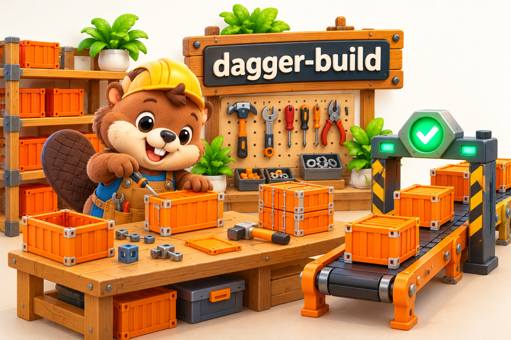

# dagger-build

Shared Go build tooling for Osixia container images, using the standalone
[Dagger Go SDK](https://docs.dagger.io/reference/client-libraries/).
Requires Go 1.26.1 or newer. Dagger SDK/engine version: **0.21.10**.



## Packages

| Package | Responsibility |
| --- | --- |
| `cmd` | Cobra commands for jobs and CI providers |
| `config` | Image metadata, platforms, build exclusions, and tag policies |
| `job` | Build, export, test, deploy, and publish jobs and customization hooks |
| `job/test` | Generic entrypoint version check |
| `provider` | GitHub branch/PR test and tag/release pipeline |
| `helpers` | CLI setup, tag comparison, changelog, and GitHub release helpers |

This is a library, with no standalone `main` program. Each image project owns
its executable, image matrix, build arguments, and integration tests.

## Use in a project

After this repository has been published, add it with `go get
github.com/osixia/dagger-build@<existing-tag-or-commit>` and use its packages:

```go
package main

import (
    "context"
    "os"

    "github.com/osixia/dagger-build/cmd"
    "github.com/osixia/dagger-build/config"
)

func main() {
    image := &config.Image{
        BaseImage: "debian:trixie-slim",
        Distribution: config.Debian,
        Name: "example/image",
        TagPrefixes: []string{"debian"},
    }
    config.Images = []*config.Image{image}
    config.DefaultImage = image
    config.ProjectGithubRepo = &config.GithubRepo{
        Organization: "example",
        Project: "image",
    }
    if err := cmd.Run(context.Background()); err != nil {
        os.Exit(1)
    }
}
```

The image Dockerfile must accept `BASE_IMAGE` and `IMAGE` build arguments.
The default test job expects its entrypoint's `--version` output to equal
`<image-name>:<longest-generated-tag>` followed by an optional newline.
Customize `job.BuildArgs`, `job.BuildTags`, or job functions before `cmd.Run`.

For project-specific checks, assign `job.Test` in the consuming executable:
call `job.DefaultTest` first, then run the project's checks on the returned
containers. Keep those checks in the consuming repository. Branch/PR runs and
the deployment pipeline also use this hook.

```bash
go run . --help
go run . job test ../Dockerfile --distributions debian --arches amd64
```

The test job builds and optionally exports files; it does not publish images.
Deploy, publish, and GitHub tag runs can push images and modify GitHub releases
and release assets. Run them only when publication is intended.

## Native multi-arch builds

Building other architectures under QEMU is slow and can crash compilers. Each
architecture can instead be built and tested on its own native runner, then
deployed together as a single multi-arch image per tag:

```bash
# on an amd64 runner, then on an arm64 runner with --arches arm64
go run . provider github ../Dockerfile --arches amd64 --github-ref "$GITHUB_REF" --github-token "$GITHUB_TOKEN" --oci-export-to ../oci

# on any runner, with the archives of all runners in ../oci
go run . provider github ../Dockerfile --github-ref "$GITHUB_REF" --github-token "$GITHUB_TOKEN" --oci-import-from ../oci --username "$USER" --password "$PASSWORD"
```

`--oci-export-to` writes one OCI archive per image and architecture, named
`<image-name>_<first-tag-prefix-or-default><tags-suffix>_<arch>.tar`. On tags,
the GitHub provider only builds, tests, and exports them. `--oci-import-from`
imports these archives instead of building, checks their platform, and does
not test them again before deploying: they were tested by the runs that built
them. File exports such as `--export` read the imported images. Pass archives
between CI jobs as artifacts; nothing is pushed to the registry before the
final deploy, so it only gets the multi-arch tags.

Deploy records each image digest once in `--digests-file`, even when several
tags share it, so each image is signed once.

## Local development and initial extraction

The initial `container-baseimage/build/go.mod` uses a local replacement pointing
to a sibling `dagger-build` checkout. Its CI temporarily checks out this
repository's `main` branch. This works after the first push; no remote version
exists before then. After publishing a tag or commit, replace the bootstrap
dependency with that version and remove the temporary CI checkout.

Go resolves the shared library from the local checkout, so no commit or push
is needed for local validation. If the consumer vendors dependencies, regenerate
them with `go mod vendor` after changing the library.

## Validation

```bash
go test -race ./...
go vet ./...
go build ./...
```

Run integration tests from a consuming project as well. For example, from
`../container-baseimage/build`:

```bash
go run . job test ../Dockerfile --target base --distributions debian --arches amd64
go run . job test ../Dockerfile --target nonroot --tags-suffix=-nonroot --distributions alpine --arches amd64
```
